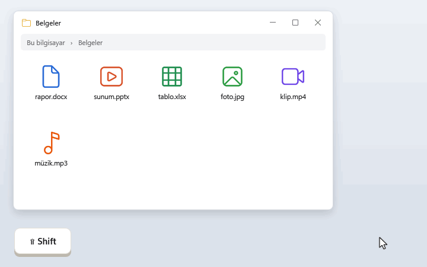
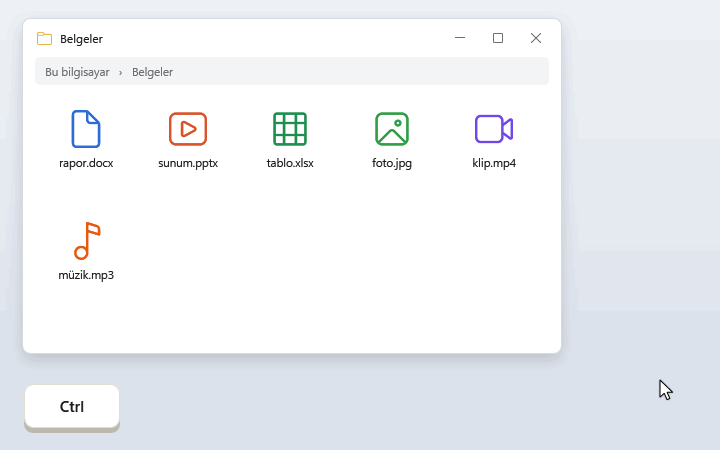
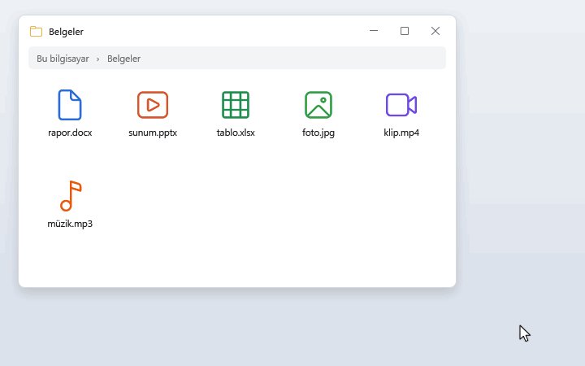
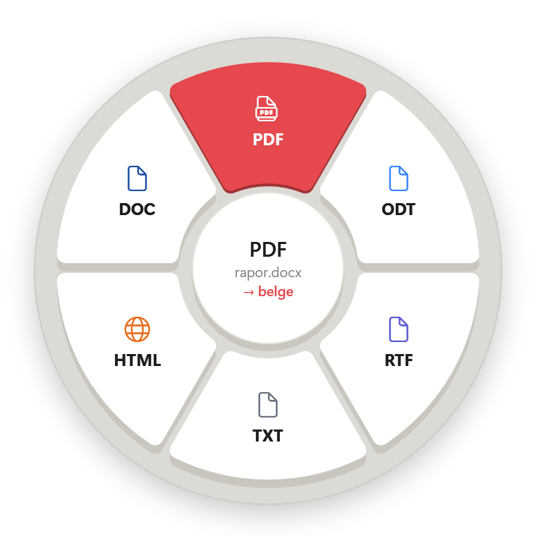
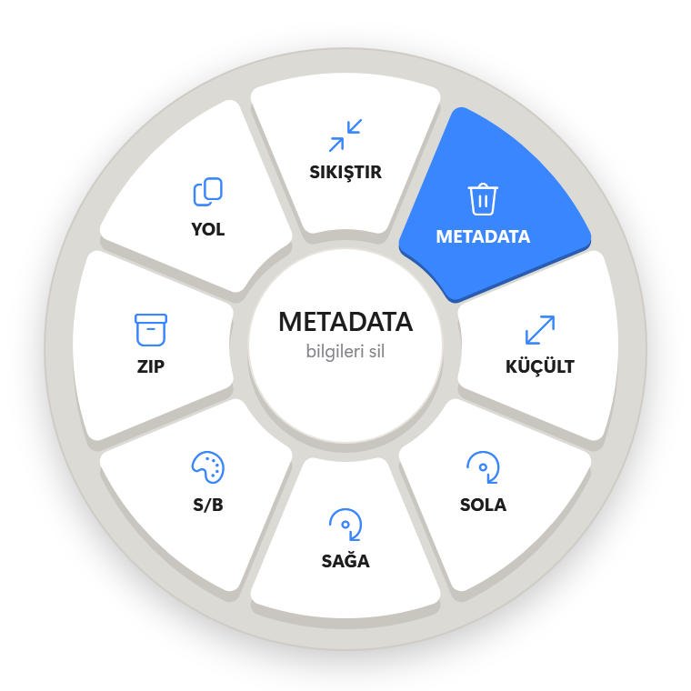
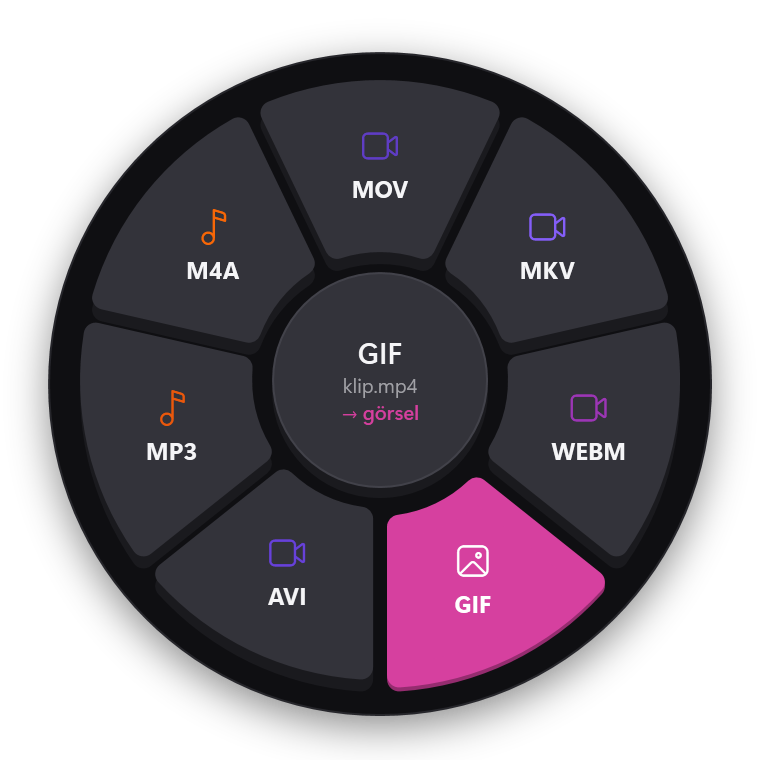
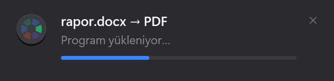
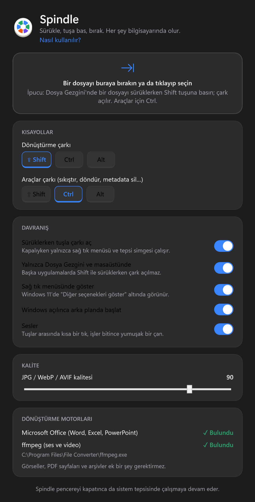

# Spindle

**Windows için çevrimdışı dosya dönüştürücü. Sürükle, tuşa bas, bırak.**

Dosya Gezgini'nde bir dosyayı sürüklerken **Shift**'e basın: imlecin etrafında bir tuş takımı açılır.
Dosyayı istediğiniz biçimin tuşuna bırakın; dönüştürülmüş kopya orijinalin yanına kaydedilir.
Her şey bilgisayarınızda olur; hiçbir dosya internete gönderilmez.

**[⬇ Spindle.exe'yi indir](https://github.com/Omrndr/spindle/releases/latest/download/Spindle.exe)** · Windows 10/11 · 52 MB · [kurulum ve gereksinimler](#kurulum) · [tanıtım sayfası](https://korayakdogan.me/spindle/)

<p align="center"></p>

Arayüz, macOS'taki [Tangerine](https://tangerineformac.com)'den esinlenmiştir.

## Nasıl kullanılır?

Spindle ilk açıldığında aşağıdaki üç kısa tanıtımı gösterir. Sonra tepsi simgesinin menüsünden ya da
Ayarlar'daki **Nasıl kullanılır?** bağlantısından yeniden açılabilir.

### 1. Sürükle + Shift: dönüştür

Bir dosyayı sürüklerken **Shift**'e basın, açılan tuşlardan birine bırakın. İmlecin altındaki tuş beklemeden basılır
ve hedef biçimin rengine boyanır; ortadaki yuvarlak tuş ne olacağını yazar (`PDF · rapor.docx · → belge`).
Köşedeki kart ilerlemeyi gösterir, iş bitince **Göster** ile yeni dosyayı açar.

### 2. Sürükle + Ctrl: araçlar

<p align="center"></p>

**Ctrl** ile araçlar açılır: sıkıştır, küçült, döndür, metadata sil, sesi çıkar… Sonuç yine orijinalin yanına,
yeni bir adla kaydedilir (`foto (sıkıştırılmış).jpg`).

### 3. Sağ tık menüsü

<p align="center"></p>

Sürüklemek istemezseniz dosyaya sağ tıklayıp **Spindle ▸ Dönüştür…** ya da **Araçlar…** seçin, sonra tuşa tıklayın.
Menü Ayarlar'dan (ya da tanıtımın son sayfasından) açılır. Windows 11'de "Diğer seçenekleri göster" altındadır.

Kısayol tuşları Ayarlar'dan değiştirilebilir (Shift, Ctrl, Alt). Birden fazla dosya seçerseniz çark yalnızca
hepsinde ortak olan seçenekleri gösterir. Çıktılar hiçbir zaman var olan bir dosyanın üzerine yazılmaz
(`rapor 2.pdf` gibi yeni ad alır).

## Desteklenen biçimler

### Dönüştürme (Shift)

Kaynakla aynı biçim çarkta gösterilmez (ör. DOCX dosyası için DOCX tuşu yoktur).

| Tür | Açılabilen dosyalar | Dönüştürülebildiği biçimler | Gereken |
|---|---|---|---|
| Word belgesi | doc, docx, docm, dot, dotx, rtf, odt, txt | PDF, DOCX, ODT, RTF, TXT, HTML, DOC | Microsoft Office |
| Excel tablosu | xls, xlsx, xlsm, ods, csv | PDF, XLSX, CSV, ODS, XLS | Microsoft Office |
| PowerPoint sunusu | ppt, pptx, pps, ppsx, odp | PDF, PPTX, PNG (her slayt ayrı), ODP, PPT | Microsoft Office |
| PDF | pdf | DOCX (Office gerekir), PNG ve JPG (her sayfa ayrı) | — |
| Görsel | jpg, jpeg, jfif, png, webp, heic, heif, avif, bmp, tif, tiff, gif, ico, svg, psd, tga | PNG, JPG, WEBP, PDF, AVIF, TIFF, BMP, GIF, ICO | — |
| Fotoğraf makinesi RAW | raf (Fujifilm), raw (Panasonic/Leica), dng, cr2, cr3 (Canon), nef (Nikon), arw (Sony), orf (Olympus), rw2 (Panasonic), pef (Pentax), srw (Samsung) | PNG, JPG, WEBP, PDF, AVIF, TIFF, BMP, GIF, ICO | — |
| Ses | mp3, m4a, wav, flac, ogg, oga, opus, aiff, aif, wma, aac | MP3, M4A, WAV, FLAC, OGG, OPUS, AIFF, AAC | ffmpeg |
| Video | mp4, m4v, mov, mkv, webm, avi, wmv, flv, mpg, mpeg, 3gp, ts | MP4, MOV, MKV, WEBM, GIF, AVI; sesi MP3 ya da M4A olarak | ffmpeg |
| Arşiv | zip, tar, tar.gz, tgz | ZIP | — |

### Araçlar (Ctrl)

| Tür | Araç | Çıktı |
|---|---|---|
| Görsel | Sıkıştır | `foto (sıkıştırılmış).jpg` |
| | Metadata sil (konum, kamera bilgisi…) | `foto (temiz).jpg` |
| | %50 küçült | `foto (küçük).jpg` |
| | Sola / sağa 90° döndür | `foto (döndürülmüş).jpg` |
| | Siyah-beyaz | `foto (siyah-beyaz).jpg` |
| Video | Sıkıştır | `klip (sıkıştırılmış).mp4` |
| | 720p'ye düşür | `klip (720p).mp4` |
| | Sesi kaldır | `klip (sessiz).mp4` |
| | Sesi MP3 olarak al | `klip.mp3` |
| Ses | Sıkıştır | `müzik (sıkıştırılmış).mp3` |
| | Ses seviyesini dengele | `müzik (dengelenmiş).mp3` |
| Arşiv | Klasöre aç | `arşiv` klasörü |
| Her dosya ve klasör | ZIP'le, yolu kopyala | `rapor.zip`, panoya dosya yolu |

## Görünüm

<p align="center">
  
  
  
</p>

- **Her tuş hedef dosyanın ailesini gösterir:** belge mavi (PDF kırmızı), tablo ve görsel yeşil, video mor, ses turuncu.
  Araçlar çarkı tek renktir (mavi). Windows'un açık/koyu temasına uyar.
- **Office ya da ffmpeg kurulu değilse** ilgili tuşlar soluk görünür; üzerine gelince ortada "Office gerekli" /
  "ffmpeg gerekli" yazar ve dosya bırakılamaz.
- **Sesler:** tuşlar arasında geçerken kısa, tok bir tık; sıradaki işler bitince kısa, yumuşak bir çan.
  Ayarlar'dan kapatılabilir. Ses dosyası yoktur; iki ses ilk kullanımda bellekte üretilir (~32 KB).
- **Bildirim kartı:** arka planda olan hiçbir şey görünmez (Word, Excel, PowerPoint ve ffmpeg gizli çalışır);
  yalnızca köşedeki kart görünür. Soldaki logonun dilimleri sırayla yanar, çubuk yüzde olarak dolar.

<p align="center">
  
  
</p>

## Kurulum

**[Spindle.exe'yi indirin](https://github.com/Omrndr/spindle/releases/latest/download/Spindle.exe)** (Windows, 52 MB) ve çalıştırın.

Kurulum programı yoktur: Spindle ilk açılışta kendini `%LOCALAPPDATA%\Programs\Spindle` klasörüne kopyalar,
Başlat menüsüne ve Windows'un **Uygulamalar** listesine ekler, sonra tanıtımı gösterir. Yönetici izni gerekmez.

- Uygulama imzalı olmadığı için Windows SmartScreen "Windows bilgisayarınızı korudu" diyebilir:
  **Ek bilgi → Yine de çalıştır**.
- Güncellemek için yeni `Spindle.exe`'yi indirip çalıştırın; çalışan sürüm kapanır, ayarlarınız korunur.
- Kaldırmak için: Windows Ayarları → **Uygulamalar** → Spindle → **Kaldır**. Sağ tık menüsü, otomatik başlatma ve
  ayarlar da silinir.
- Sağ tık menüsü, "Windows açılınca başlat" ve sesler Spindle'ın Ayarlar'ından açılıp kapatılır.

<p align="center"></p>

### Gereksinimler

- Windows 10 (2004) veya Windows 11 ve [.NET 10 Masaüstü Çalışma Zamanı](https://dotnet.microsoft.com/download/dotnet/10.0)
  (yoksa Spindle açılırken indirme bağlantısını gösterir)
- Word/Excel/PowerPoint dönüşümleri ve PDF → Word için **Microsoft Office** (Microsoft 365 dahil)
- Ses ve video için **ffmpeg**. Ayarlar'daki "ffmpeg'i kur" düğmesi `winget install Gyan.FFmpeg` çalıştırır.
- Görseller, PDF sayfaları ve arşivler ek bir şey gerektirmez.

### Kaynaktan kurmak

```powershell
git clone https://github.com/Omrndr/spindle.git
cd spindle
powershell -File scripts\install.ps1
```

Betik tek dosyalık `Spindle.exe`'yi derleyip çalıştırır; exe kendini yukarıdaki gibi kurar.
`scripts\uninstall.ps1` her şeyi soru sormadan kaldırır.

## Word → PDF neden çalışıyor?

Bu proje, [File Converter](https://github.com/Tichau/FileConverter) 2.2'nin Word → PDF yapamaması üzerine başladı.
File Converter 2.2, Office ile konuşmak için NetOffice adlı ek DLL'lere geçti ama bu DLL'ler kurulum paketine
konmadı; Office kurulu olsa bile dönüşüm `FileNotFoundException` ile çöküyor
([Tichau/FileConverter#721](https://github.com/Tichau/FileConverter/issues/721)).

Spindle Office'e hiçbir ek DLL olmadan, doğrudan Windows'un COM altyapısıyla (`Word.Application`) bağlanır. Ayrıca:

- Office görünmez çalışır. Beklenmedik bir uyarı açarsa Spindle onu daha ekrana gelmeden saydam yapıp
  ekran dışına taşır ve yanıtlar. Word'ün PDF uyarısını gösteren ayrı `PDFREFLOW.EXE` işlemi de izlenir.
- Office (ve PDFREFLOW gibi yardımcıları) uzun süre hiç işlemci kullanmadan beklerse takılmış sayılır: önce
  yardımcı işlemler kapatılır, Office yine yanıt vermezse yalnızca Spindle'ın başlattığı Office kapatılır.
- Zaten açık olan Word/Excel'inize bağlanırsa içindeki belgelerinize ve ayarlarına (ör. görünürlüğüne) dokunmaz.

## Hız

Aynı bilgisayarda, aynı dosyalarla (12 çekirdek, Microsoft 365), File Converter 2.2 ile karşılaştırma:

| Senaryo | File Converter 2.2 | Spindle |
|---|---|---|
| Word → PDF (küçük belge) | çöküyor (eksik DLL) | 4,5 sn; çark açıkken Word önceden başlatıldığında 1,4 sn |
| 3 küçük Word belgesi art arda | çöküyor | 2,6 sn (tek Word örneği) |
| 10 JPG (6 MP) → PNG | 7,4 sn | 2,8 sn |
| WAV (60 sn) → MP3 | 1,4 sn | 0,8 sn |
| MP4 1080p (15 sn) → WEBM | 4 dakikada bitmedi | 20 sn |

- **Word sıcak tutulur.** Word'ü açmak tek başına ~3,5 sn sürer. Spindle çark bir Office belgesi için açıldığı
  anda Word'ü arka planda başlatır ve art arda gelen dosyalarda aynı Word'ü kullanır; iş bitince birkaç saniye
  içinde kapatır.
- **Çok dosyalı işler paralel çalışır:** görseller çekirdek sayısına göre (en fazla 6), ses/video ikişer.
  Office dosyaları tek Word örneğinde sırayla çevrilir.
- **WEBM** için VP9 hızlı kalite ayarıyla (`-cpu-used 4`) kodlanır: varsayılandan ~3,4 kat hızlı, kalite farkı
  ölçülemeyecek kadar az (SSIM 0,9975 → 0,9968).

Çok sayıda metin kutusu ve denklem içeren büyük Word belgelerinde süreyi Word'ün kendi PDF çizimi belirler
(85 sayfa, 870 metin kutusu, 324 denklemli bir belgede ~2 dakika). Bu adım Word'ün içinde olduğu için
Word kullanan her dönüştürücüde aynıdır.

## Kaynak kullanımı

| | File Converter 2.2 | Spindle |
|---|---|---|
| Kurulum boyutu | 147 MB | 52 MB, tek dosya (üç tanıtım GIF'i dahil, toplam ~540 KB) |
| Boşta | arka planda süreç yok (sağ tık eklentisi Gezgin'in içinde yüklenir) | tepside bekler: ~7 MB RAM, işlemci ~0 |
| Bir pencere açılıp kapandıktan sonra | — | 30 sn içinde ~12 MB RAM'e iner |
| 6 MP JPG → PNG sırasında tepe bellek | 180 MB | 119 MB |
| WAV → MP3 sırasında tepe bellek | 100 MB (+ ffmpeg 18 MB) | 48 MB (+ ffmpeg 18 MB) |
| Word dönüşümü | çöküyor | Word'ün kendi belleği (~250 MB) iş sırasında ve sonrasında en fazla 8 sn (çark açıkken önceden başlatıldıysa 25 sn) |

- **Fare izlenmez.** Yalnızca bir klavye kancası vardır; Shift/Ctrl/Alt/Esc dışındaki tuşlarda hiçbir şey yapmaz.
  Tetik tuşuna basıldığı anda sol fare tuşunun basılı olup olmadığına bir kez bakılır. Sürüklemenin devamı
  yalnızca çark açıkken, 50 ms'de bir izlenir.
- **Boşta bellek iade edilir:** 30 sn boyunca pencere açık değilken ve dönüşüm yokken kullanılmayan bellek
  Windows'a geri verilir.
- Office/ffmpeg kurulu mu bilgisi 30 sn önbellekte tutulur; her çark açılışında kayıt defteri ve disk taranmaz.
- **Bildirim kartı** saydam (katmanlı) pencere değildir; gölgeyi ve yuvarlak köşeleri Windows çizer, kart saniyede
  8 kez güncellenir. "Program yükleniyor" sırasında tek çekirdeğin ~%1,8'i (dönen oklu, saydam pencereli ilk
  sürümde %24,4'tü).
- **Tanıtım GIF'leri** ilk turda bir kez çözülür; sonraki turlarda yalnızca değişen küçük bölgeler ekrana yazılır
  (tek çekirdeğin ~%0,8'i). Pencere gizlenince oynatma durur.

## Bilinen sınırlar

- **PDF → Word** Word'ün kendi PDF dönüştürücüsünü kullanır: metin düzenlenebilir hale gelir ama çok görselli
  ya da karmaşık sayfalar özgün PDF'le birebir aynı görünmeyebilir. Taranmış (yalnızca resim olan) PDF'lerde
  sayfalar metin değil resim olarak gelir. Office'in daha önce takıldığı bir PDF'te Word "ciddi hataya neden oldu"
  diye sorar; Spindle bu güvenlik sorusunu "Hayır"la yanıtlar ve dönüşüm iptal edilir.
- HEIC ve RAW dosyaları okunabilir ama aynı biçimde kaydedilemez; bu dosyalarda araçların sonucu JPG olarak kaydedilir
  (`DSCF0065 (sıkıştırılmış).jpg`). RAW'lar makinenin kaydettiği beyaz dengesiyle açılır; 26 MP'lik bir Fujifilm RAF
  JPG'ye ~9 sn'de çevrilir ve sırasında ~570 MB bellek kullanır, bu yüzden RAW'lar aynı anda en fazla iki tane çevrilir.
  PNG'ye 8 bit, TIFF'e 16 bit yazılır.
- Sürükle + tuş hareketi varsayılan olarak yalnızca Dosya Gezgini ve masaüstünde çalışır (Ayarlar'dan değiştirilebilir).

## Geliştirme

```powershell
dotnet build
dotnet test       # Office ve ffmpeg kuruluysa gerçek dönüşümleri de dener
dotnet run --project src\Spindle
```

| Klasör | İçerik |
|---|---|
| `src/Spindle.Core` | Biçim kataloğu ve dönüştürme motorları (Office, Magick.NET, ffmpeg, Windows PDF, arşiv) |
| `src/Spindle` | WPF uygulaması: çark, bildirim kartı, ayarlar, tanıtım, tepsi simgesi, sürükleme algılama, sesler |
| `src/Spindle/Tour` | Tanıtım GIF'lerini çizen sahne (uygulamanın gerçek çarkı ve kartıyla, ekrana pencere açmadan) |
| `tests/Spindle.Tests` | Katalog testleri ve gerçek dosyalarla dönüşüm testleri |
| `docs` | README görselleri ve tanıtım GIF'leri (GIF'ler uygulamanın içine de gömülür) |

Derlenen uygulama: `src\Spindle\bin\Debug\net10.0-windows10.0.19041.0\win-x64\Spindle.exe`. Komut satırı:

| Komut | Ne yapar |
|---|---|
| `--convert to:pdf rapor.docx` | Arayüzsüz dönüştürür; sonuçlar `%LOCALAPPDATA%\Spindle\son-donusum.log` dosyasına yazılır |
| `--wheel dosya` / `--tools dosya` | Çarkı imlecin yanında açar (sağ tık menüsü bunu kullanır) |
| `--tour` / `--settings` | Tanıtımı ya da Ayarlar'ı açar |
| `--uninstall` | Spindle'ı kaldırır (Uygulamalar listesindeki Kaldır düğmesi bunu çağırır) |
| `--render-tour docs` | Üç tanıtım GIF'ini yeniden üretir |
| `--snapshot cikti.png convert 0 dosya` | Çarkı görsele çizer (`--dark`, `--no-office` eklenebilir) |
| `--snapshot-ui klasör` | Kart, Ayarlar ve tanıtım penceresi görsellerini çizer |
| `--render-icon spindle.ico` | Uygulama simgesini logodan üretir |
| `--export-sounds klasör` | Tık ve çan seslerini WAV olarak yazar |
